# ColetaHub · Checkpoint 2 de ASP.NET Core MVC

| Integrante | RM |
|---|---|
| Raphael Oliveira Sinelli Mendonça | **RM 568346** |
| Henrique Spoltore Moreno Pavão dos Santos | **RM 568130** |

**FIAP · Análise e Desenvolvimento de Sistemas · Prof. Dr. Marcel Stefan Wagner**
Repositório: https://github.com/Raphael-Sinelli/coletahub-cp2-dotnet

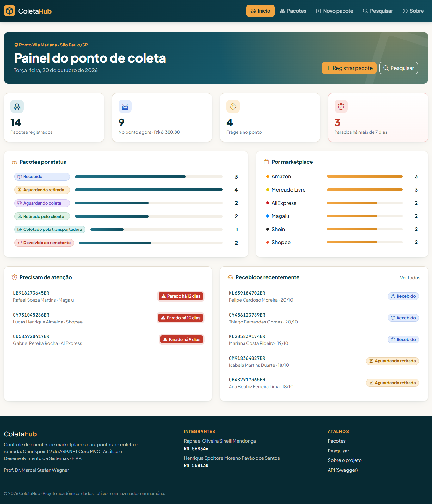

---

## Sumário

1. [Tema e problema](#1-tema-e-problema)
2. [Tecnologias e versões](#2-tecnologias-e-versões)
3. [Pacotes NuGet](#3-pacotes-nuget)
4. [Pré-requisitos e extensões do Visual Studio](#4-pré-requisitos-e-extensões-do-visual-studio)
5. [Como executar](#5-como-executar)
6. [Diagramas](#6-diagramas)
7. [Estrutura de pastas](#7-estrutura-de-pastas)
8. [Padrões aplicados](#8-padrões-aplicados)
9. [Modelo de dados](#9-modelo-de-dados)
10. [Tag Helpers](#10-tag-helpers)
11. [Endpoints](#11-endpoints)
12. [Telas](#12-telas)
13. [Testes](#13-testes)
14. [Confirmação de exclusão](#14-confirmação-de-exclusão)
15. [Persistência em memória](#15-persistência-em-memória)
16. [Melhorias futuras](#16-melhorias-futuras)
17. [Decisões registradas](#17-decisões-registradas)

---

## 1. Tema e problema

Farmácias, papelarias e lojas de bairro viraram **pontos de coleta e retirada** de marketplaces como Mercado Livre, Shopee e Amazon. Todo dia chegam dezenas de pacotes ao balcão. Alguns o cliente vem buscar, outros a transportadora recolhe, e os que passam do prazo de guarda voltam ao remetente. Sem controle, o operador:

- perde tempo procurando a caixa certa quando o cliente chega;
- esquece pacotes parados há dias, que acabam devolvidos e geram reclamação;
- não sabe quanto valor em mercadoria está sob a guarda do ponto.

O **ColetaHub** é o sistema web desse operador. Ele registra cada pacote que chega (código de rastreio, destinatário, CPF, marketplace, peso, valor, fragilidade) e acompanha o **status** até a saída. O painel destaca os pacotes **parados há mais de 7 dias**, e a pesquisa encontra qualquer pacote pelo código ou pelo nome do destinatário. Os dados de exemplo simulam um ponto na **Vila Mariana, São Paulo/SP**, com destinatários e remetentes de cidades paulistas (Osasco, Santo André, Guarulhos, Campinas, São José dos Campos).

O que o sistema entrega:

- **CRUD completo** de pacotes no navegador (Create, Read, Update, Delete);
- **pesquisa** por texto (código ou destinatário), status, marketplace e intervalo de datas;
- **painel** com totais, contagem por status e por marketplace, pacotes frágeis e parados;
- **API REST** com os mesmos dados, documentada no Swagger e testada com Postman;
- **sem banco de dados**, com persistência em memória.

---

## 2. Tecnologias e versões

| Tecnologia | Versão | Uso |
|---|---|---|
| .NET SDK | 10.0.301 (fixado em `global.json`, `rollForward: latestFeature`) | Compilação |
| Target framework | **net8.0** (LTS) | Web e testes |
| ASP.NET Core MVC | 8.0 | Controllers, Views Razor, Tag Helpers |
| C# | 12 | Linguagem |
| Bootstrap | 5.1.0 (vem no template, em `wwwroot/lib`) | Grid, componentes, modal |
| Bootstrap Icons | 1.11.3 (CDN jsDelivr) | Ícones |
| Google Fonts | Plus Jakarta Sans e JetBrains Mono | Tipografia (texto e códigos) |
| jQuery | 3.6.0 | Base do jQuery Validate |
| jQuery Validation + Unobtrusive | 1.19.5 / 4.0.0 | Validação no navegador |
| Swagger UI (Swashbuckle) | 6.9.0 | Documentação OpenAPI |
| xUnit | 2.9.3 | Testes automatizados |
| Postman / Newman | Coleção v2.1 / Newman 6.2.1 | Testes da API |
| Playwright (Edge) | 1.49.1 | Captura dos prints deste README |

---

## 3. Pacotes NuGet

| Projeto | Pacote | Versão | Finalidade |
|---|---|---|---|
| ColetaHub.Web | `Swashbuckle.AspNetCore` | 6.9.0 | Gera o documento OpenAPI e a interface Swagger em `/swagger` (só em Development). Lê os comentários `///` do XML de documentação |
| ColetaHub.Tests | `xunit` | 2.9.3 | Framework de testes |
| ColetaHub.Tests | `xunit.runner.visualstudio` | 2.8.2 | Executa os testes no Test Explorer e no `dotnet test` |
| ColetaHub.Tests | `Microsoft.NET.Test.Sdk` | 17.12.0 | Host de testes do .NET |
| ColetaHub.Tests | `coverlet.collector` | 6.0.4 | Coleta de cobertura (`dotnet test --collect:"XPlat Code Coverage"`) |

O projeto Web não usa nenhum pacote além do Swashbuckle. MVC, Tag Helpers, validação, localização e DI vêm do próprio `Microsoft.AspNetCore.App`.

---

## 4. Pré-requisitos e extensões do Visual Studio

**O projeto usa `net8.0` justamente para abrir e rodar tanto no Visual Studio 2022 quanto no Visual Studio 2026.** O .NET 10 só é suportado no VS 2026. Com o .NET 8 (LTS), quem tiver qualquer uma das duas versões consegue abrir a solução e apertar F5.

Pré-requisitos:

- **Visual Studio 2022 (17.8 ou superior) ou Visual Studio 2026**, com a carga de trabalho **"ASP.NET e desenvolvimento Web"**;
- **SDK do .NET 8 ou superior** (o `global.json` aceita o SDK 10.0.301 ou posterior; com o SDK 10 instalado, o VS compila `net8.0` normalmente);
- **runtime ASP.NET Core 8** (vem com o SDK 8; quem tem só o SDK 10 precisa instalar o [ASP.NET Core Runtime 8](https://dotnet.microsoft.com/download/dotnet/8.0) para executar);
- certificado HTTPS de desenvolvimento: `dotnet dev-certs https --trust` (o VS oferece isso no primeiro F5).

> Se a sua máquina tiver apenas o SDK 8, apague o `global.json` ou troque a versão para `8.0.100`. O código não usa nada exclusivo do SDK 10.

Extensões recomendadas (todas opcionais):

| Extensão | Para quê |
|---|---|
| Razor Language Services / Web Tools (nativo) | IntelliSense dos Tag Helpers customizados nas views |
| Test Explorer (nativo) | Rodar os 67 testes xUnit |
| Markdown Editor v2 | Visualizar este README com os diagramas Mermaid |
| Postman (app desktop) ou Postman for VS Code | Importar e rodar a coleção em `docs/postman` |

---

## 5. Como executar

### Pelo Visual Studio

1. Abra **`ColetaHub.sln`**.
2. Confirme que **ColetaHub.Web** é o projeto de inicialização (já é o padrão).
3. Escolha o perfil **https** (padrão) ou **http** na barra de ferramentas.
4. Pressione **F5**. O navegador abre em `https://localhost:7159` (ou `http://localhost:5279` no perfil http).
5. Swagger: `https://localhost:7159/swagger`.
6. Testes: menu **Testar → Executar Todos os Testes**.

### Pela CLI

```bash
dotnet restore
dotnet build -c Debug
dotnet build -c Release
dotnet test

# executa o site (perfil http do launchSettings.json)
dotnet run --project src/ColetaHub.Web --launch-profile http
# → http://localhost:5279   ·   Swagger: http://localhost:5279/swagger
```

### Gerar o .zip de entrega

```powershell
./empacotar.ps1
```

O script compila em Debug e Release, roda os testes e gera **`ColetaHub_CP2.zip`** com a pasta inteira: `.sln`, `src`, `tests`, `docs`, `bin/Debug` e `bin/Release`. Ficam de fora só os arquivos ignorados pelo Git (como `.vs` e `node_modules`); `bin` e `obj` entram mesmo sendo ignorados. Feche o Visual Studio e pare a aplicação antes de rodar, porque um executável em uso impede o build.

---

## 6. Diagramas

As fontes estão em [`docs/diagramas`](docs/diagramas) (`.mmd`), com versões em PNG. O GitHub renderiza os blocos Mermaid abaixo diretamente.

### 6.1 Fluxo MVC

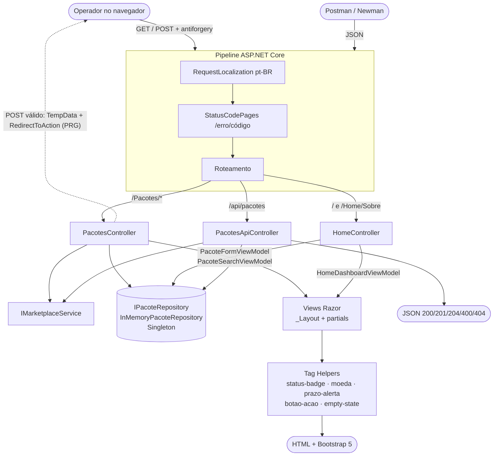

### 6.2 Diagrama de classes

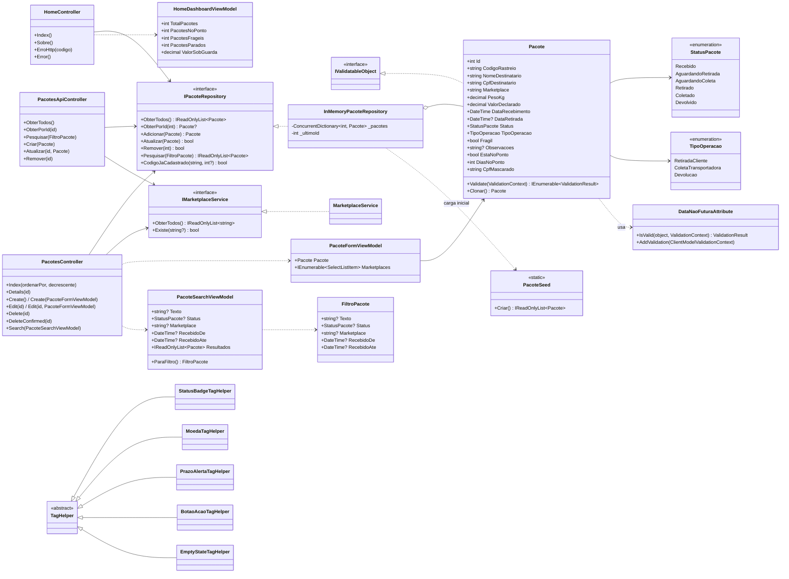

Versões em imagem: [fluxo-mvc.png](docs/diagramas/fluxo-mvc.png) · [classes.png](docs/diagramas/classes.png) · [sequencia-exclusao.png](docs/diagramas/sequencia-exclusao.png) (diagrama de sequência da [seção 14](#14-confirmação-de-exclusão)).

---

## 7. Estrutura de pastas

```text
Cp2/
├── ColetaHub.sln                      # Solution no formato clássico (.sln), abre no VS 2022 e 2026
├── global.json                        # Fixa o SDK (10.0.301, rollForward latestFeature)
├── empacotar.ps1                      # Build Debug/Release + testes + ColetaHub_CP2.zip
├── entrega.txt                        # Link do repositório e integrantes
├── README.md
├── docs/
│   ├── diagramas/                     # Fontes Mermaid (.mmd) e PNGs
│   ├── postman/
│   │   ├── ColetaHub.postman_collection.json   # 13 requisições com testes
│   │   └── relatorio-newman.html               # Relatório da última execução
│   └── prints/                        # Prints das telas e dos testes
│       └── tag-helpers/               # Recortes de cada Tag Helper renderizado
├── src/ColetaHub.Web/                 # Projeto ASP.NET Core MVC (net8.0)
│   ├── Program.cs                     # DI, cultura pt-BR, páginas de status, Swagger, rotas
│   ├── Controllers/
│   │   ├── HomeController.cs          # Painel, Sobre, erro e 404
│   │   ├── PacotesController.cs       # CRUD + Search (MVC)
│   │   └── Api/PacotesApiController.cs# API REST em /api/pacotes
│   ├── Models/
│   │   ├── Pacote.cs                  # Entidade + Data Annotations + IValidatableObject
│   │   ├── StatusPacote.cs            # enum com [Display] em português
│   │   ├── TipoOperacao.cs            # enum com [Display] em português
│   │   ├── FiltroPacote.cs            # Critérios de pesquisa
│   │   ├── EnumExtensions.cs          # ObterNomeExibicao() lê o [Display]
│   │   └── ErrorViewModel.cs
│   ├── Validation/
│   │   └── DataNaoFuturaAttribute.cs  # Atributo customizado (servidor + cliente)
│   ├── Repositories/
│   │   ├── IPacoteRepository.cs       # Contrato do repositório
│   │   ├── InMemoryPacoteRepository.cs# ConcurrentDictionary + Interlocked (Singleton)
│   │   └── PacoteSeed.cs              # 14 pacotes iniciais
│   ├── Services/
│   │   ├── IMarketplaceService.cs
│   │   └── MarketplaceService.cs      # Catálogo que alimenta o dropdown
│   ├── ViewModels/                    # PacoteFormViewModel, PacoteSearchViewModel, HomeDashboardViewModel
│   ├── TagHelpers/                    # 5 Tag Helpers próprios
│   ├── Views/
│   │   ├── _ViewImports.cshtml        # @addTagHelper *, ColetaHub.Web
│   │   ├── Home/                      # Index (painel) e Sobre
│   │   ├── Pacotes/                   # Index, Details, Create, Edit, Delete, Search, _Form, _LinhaPacote
│   │   └── Shared/                    # _Layout, _Alertas, _ModalExclusao, _ValidationScriptsPartial, Error, NaoEncontrado
│   └── wwwroot/
│       ├── css/site.css               # Identidade visual (variáveis CSS)
│       ├── js/site.js                 # Modal, máscaras, alertas que somem
│       ├── js/validacao-ptbr.js       # Vírgula decimal + adaptador DataNaoFutura
│       ├── favicon.svg
│       └── lib/                       # Bootstrap, jQuery, jQuery Validate (template)
└── tests/ColetaHub.Tests/             # xUnit (net8.0)
    ├── InMemoryPacoteRepositoryTests.cs
    ├── PacotesControllerTests.cs
    ├── PacotesApiControllerTests.cs
    ├── ValidacaoPacoteTests.cs
    └── PacoteFabrica.cs               # Objetos válidos e TempData para os testes
```

---

## 8. Padrões aplicados

| Padrão | Onde | Como |
|---|---|---|
| **MVC** | Todo o projeto Web | Controllers recebem a requisição, consultam o repositório, montam um ViewModel e devolvem uma View Razor |
| **Repository** | `Repositories/IPacoteRepository.cs`, `InMemoryPacoteRepository.cs` | Os controllers conhecem só a interface. Trocar memória por banco não exige mexer nos controllers |
| **Injeção de Dependência com Singleton** | `Program.cs` | `AddSingleton<IPacoteRepository>(_ => new InMemoryPacoteRepository(PacoteSeed.Criar()))` e `AddSingleton<IMarketplaceService, MarketplaceService>()`. Os controllers recebem as dependências pelo construtor |
| **Post/Redirect/Get (PRG)** | `PacotesController` (Create, Edit, DeleteConfirmed) | Todo POST bem-sucedido termina em `RedirectToAction`. Atualizar a página (F5) não reenvia o formulário |
| **ViewModel** | `ViewModels/` | `PacoteFormViewModel` leva o pacote e a lista de marketplaces; `PacoteSearchViewModel` leva filtros e resultados; `HomeDashboardViewModel` leva os indicadores |
| **Data Annotations** | `Models/Pacote.cs` | `[Required]`, `[StringLength]`, `[RegularExpression]`, `[Range]`, `[DataType]`, `[Display]` com mensagens em português |
| **Atributo de validação customizado** | `Validation/DataNaoFuturaAttribute.cs` | Herda de `ValidationAttribute` e implementa `IClientModelValidator`: valida no servidor e emite `data-val-datanaofutura` para o jQuery Validate |
| **IValidatableObject** | `Pacote.Validate` | Regras entre propriedades: a data de saída não pode ser anterior ao recebimento, só existe com status Retirado ou Coletado e é obrigatória nesses dois status |
| **Antiforgery** | `[ValidateAntiForgeryToken]` em todo POST; o Form Tag Helper gera o token | Protege Create, Edit e Delete contra CSRF |
| **TempData + partial** | `Views/Shared/_Alertas.cshtml` | A mensagem do POST sobrevive ao redirect e aparece no layout. O alerta some em 5 s |
| **Partial views** | `_Form`, `_LinhaPacote`, `_Alertas`, `_ModalExclusao` | O mesmo formulário serve Create e Edit; a mesma linha de tabela serve Index e Pesquisa |
| **Localização** | `Program.cs` (`RequestLocalizationOptions`) | Cultura pt-BR fixa: `dd/MM/yyyy`, vírgula decimal e R$ |

---

## 9. Modelo de dados

Entidade **`Pacote`** (`src/ColetaHub.Web/Models/Pacote.cs`). As linhas em **negrito** marcam os tipos exigidos no checkpoint.

| Propriedade | Tipo | Validações | Justificativa |
|---|---|---|---|
| `Id` | `int` | gerado pelo repositório (`Interlocked.Increment`) | Identificador incremental |
| **`CodigoRastreio`** | **`string`** | `[Required]`, `[StringLength(13, MinimumLength = 13)]`, `[RegularExpression(@"^[A-Z]{2}\d{9}BR$")]`, código único (checado no controller) | Formato das etiquetas nacionais: 2 letras, 9 dígitos e "BR" (ex.: `QB482917365BR`) |
| `NomeDestinatario` | `string` | `[Required]`, `[StringLength(100, MinimumLength = 3)]` | Nome de quem retira |
| `CpfDestinatario` | `string` | `[Required]`, `[RegularExpression(@"^\d{3}\.\d{3}\.\d{3}-\d{2}$")]` | Escolhemos CPF (e não telefone) porque é o documento conferido no balcão. A máscara JS formata enquanto o usuário digita |
| **`Marketplace`** | **`string` escolhida em lista vinda do Controller** | `[Required]`, `[StringLength(30)]`, precisa existir no catálogo (`IMarketplaceService.Existe`) | **Requisito "string escolhida pelo usuário com dados do Controller"**: `PacotesController.MontarOpcoesMarketplace()` lê o `IMarketplaceService` e envia `IEnumerable<SelectListItem>` em `PacoteFormViewModel.Marketplaces`. A view renderiza com `<select asp-for asp-items>` |
| **`PesoKg`** | **`decimal`** (número) | `[Required]`, `[Range(0.01, 30)]` | Limite comum dos pontos de coleta. Aceita vírgula (`2,35`) |
| `ValorDeclarado` | `decimal` | `[Required]`, `[DataType(DataType.Currency)]`, `[Range(0, 50000)]` | Valor da nota, exibido pelo `<moeda>` |
| **`DataRecebimento`** | **`DateTime`** | `[Required]`, `[DataType(DataType.Date)]`, **`[DataNaoFutura]`** | O pacote não pode ter chegado amanhã |
| `DataRetirada` | `DateTime?` | `[DataType(DataType.Date)]`, `[DataNaoFutura]`, regras no **`IValidatableObject`** | Não pode ser anterior ao recebimento e só existe (e é obrigatória) quando o status é Retirado ou Coletado |
| **`Status`** | **`enum StatusPacote`** | `[Required]`; cada valor tem `[Display(Name = "...")]` | Renderizado com `Html.GetEnumSelectList<StatusPacote>()` |
| `TipoOperacao` | `enum TipoOperacao` | `[Required]`; `[Display]` em cada valor | Retirada pelo cliente, coleta pela transportadora ou devolução |
| **`Fragil`** | **`bool`** | (checkbox) | Gera o selo "Frágil" na lista e conta no painel |
| `Observacoes` | `string?` | `[StringLength(300)]`, `[DataType(MultilineText)]` | Textarea com contador de caracteres |
| `DiasNoPonto` | `int` (calculada, `[NotMapped]`) | — | Dias entre o recebimento e a saída (ou hoje). Alimenta o `<prazo-alerta>` |
| `EstaNoPonto` | `bool` (calculada) | — | Status Recebido, Aguardando retirada ou Aguardando coleta |
| `CpfMascarado` | `string` (calculada) | — | `***.456.789-**` nas listagens (cuidado com LGPD) |

Valores do enum **`StatusPacote`**: Recebido, Aguardando retirada, Aguardando coleta, Retirado pelo cliente, Coletado pela transportadora, Devolvido ao remetente.

**Validação no navegador:** `_ValidationScriptsPartial` carrega o jQuery Validate, o Unobtrusive e o `wwwroot/js/validacao-ptbr.js`, que:

- troca as regras `number` e `range` para aceitar o formato brasileiro (`1.234,56`) e recusar `12.5`, que no servidor pt-BR seria lido como 125;
- registra o adaptador `datanaofutura` do atributo customizado;
- traduz as mensagens padrão do plugin.

As mensagens de model binding do servidor ("O campo X deve ser um número") também foram traduzidas no `Program.cs`.

---

## 10. Tag Helpers

### 10.1 Nativos utilizados

| Tag Helper | Onde |
|---|---|
| `asp-controller`, `asp-action`, `asp-route-id`, `asp-route-*` | Navbar, links, formulários, ordenação (`asp-route-ordenarPor`), painel (`asp-route-status`) |
| `asp-for` | Todos os `label`, `input`, `select` e `textarea` de `_Form` e `Search` |
| `asp-items` | Dropdowns de Marketplace (vindo do Controller), Status e Tipo de operação (`Html.GetEnumSelectList`) |
| `asp-validation-for` | Cada campo de `_Form` e o intervalo de datas da pesquisa |
| `asp-validation-summary="ModelOnly"` | Topo de `_Form` |
| `asp-append-version` | `site.css`, `site.js`, `validacao-ptbr.js` (cache busting) |
| `<environment>` | `_Layout`: Bootstrap não minificado em Development e minificado nos demais; link do Swagger só em Development |
| `<partial>` | `_Alertas`, `_ModalExclusao`, `_Form`, `_LinhaPacote`, `_ValidationScriptsPartial` |
| Form Tag Helper | Gera o `__RequestVerificationToken` em todo `<form method="post">` |

### 10.2 Customizados (`src/ColetaHub.Web/TagHelpers`)

Registrados em `Views/_ViewImports.cshtml` com `@addTagHelper *, ColetaHub.Web`. Todos têm comentário XML e são usados nas telas.

#### `<status-badge>`: selo colorido com ícone por status

```cshtml
<status-badge status="@item.Status" />
```
Gera `<span class="badge-status badge-status--aguardando-retirada"><i class="bi bi-hourglass-split"></i>Aguardando retirada</span>`. O texto vem do `[Display]` do enum e a cor das variáveis `--ch-status-*` do `site.css`. Usado em Index, Pesquisa, Details, Delete e no painel.

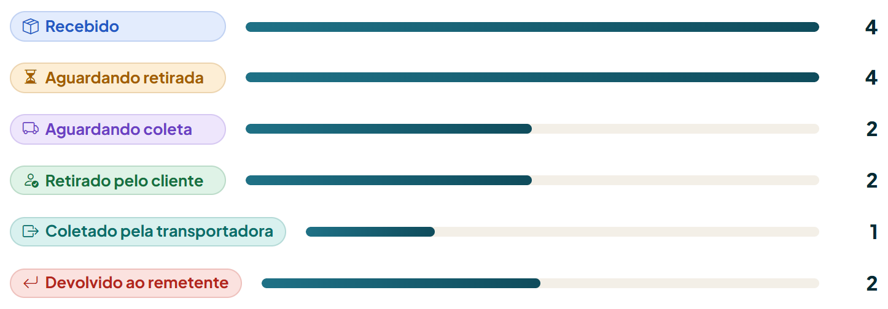

#### `<moeda>`: valor em reais pt-BR

```cshtml
<moeda valor="@item.ValorDeclarado" />
```
Formata com `CultureInfo("pt-BR")` e `"C"`: `R$ 2.349,90`, independente da cultura da requisição. Usado na tabela, em Details, em Delete e no card "No ponto agora".

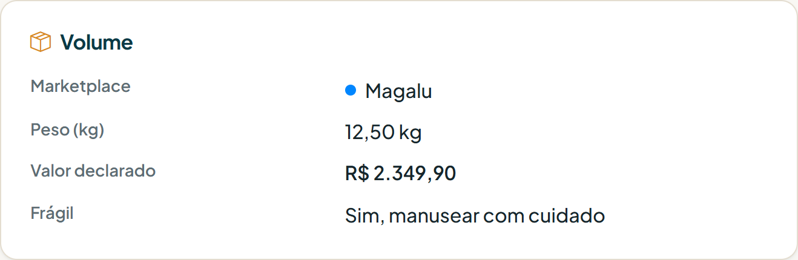

#### `<prazo-alerta>`: alerta de pacote parado

```cshtml
<prazo-alerta dias="@item.DiasNoPonto" encerrado="@(!item.EstaNoPonto)" />
```

Tem três faixas, mais um modo neutro:

| Faixa | Condição (limite padrão: `Pacote.DiasLimiteNoPonto` = 7) | Aparência |
|---|---|---|
| ok | abaixo de 5 dias | cinza ("Hoje", "1 dia", "N dias") |
| atenção | de 5 a 7 dias | âmbar |
| alerta | **mais de 7 dias** | vermelho pulsante, "Parado há N dias" |
| encerrado | pacote que já saiu | só o tempo de permanência, sem alerta |

O atributo `limite` permite outro prazo.

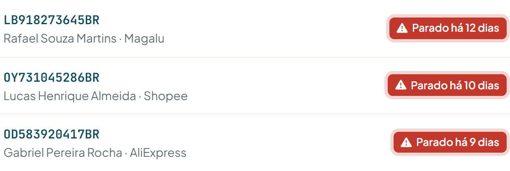

#### `<botao-acao>`: botões padronizados com ícone e rota

```cshtml
<botao-acao tipo="detalhes" id="@item.Id" descricao="@item.CodigoRastreio" compacto="true" />
<botao-acao tipo="editar"   id="@item.Id" descricao="@item.CodigoRastreio" compacto="true" />
<botao-acao tipo="excluir"  id="@item.Id" descricao="@item.CodigoRastreio" compacto="true" modal="true" />
```

- Recebe `IUrlHelperFactory` por injeção e gera a URL da action (`Details`, `Edit` ou `Delete`).
- Define a cor, o ícone, o `title` e o texto acessível.
- Com `modal="true"`, o botão excluir ganha `data-bs-toggle="modal"` e abre o modal de confirmação. Sem JavaScript, o mesmo link leva à página de confirmação.
- `compacto` mostra só o ícone.
- Um `tipo` inválido gera exceção com mensagem clara.

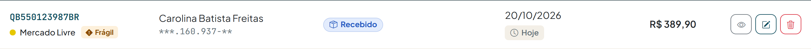

#### `<empty-state>`: lista vazia

```cshtml
<empty-state titulo="Nenhum pacote encontrado" icone="search"
             mensagem="Nenhum pacote corresponde aos filtros.">
    <a class="btn btn-outline-primary" asp-action="Search">Limpar filtros</a>
</empty-state>
```
Usa `GetChildContentAsync()` para incluir as ações passadas como conteúdo. Aparece na Index vazia, na pesquisa sem resultados e no painel ("Tudo em dia").


---

## 11. Endpoints

### 11.1 Rotas MVC

| Método | URL | Action | Descrição |
|---|---|---|---|
| GET | `/` | `HomeController.Index` | Painel com indicadores |
| GET | `/Home/Sobre` | `HomeController.Sobre` | Sobre o sistema e o grupo |
| GET | `/Pacotes?ordenarPor=codigo\|data\|status&decrescente=true\|false` | `PacotesController.Index` | Lista com ordenação por coluna |
| GET | `/Pacotes/Details/{id}` | `Details` | Detalhes (404 amigável se não existir) |
| GET | `/Pacotes/Create` | `Create` | Formulário vazio |
| POST | `/Pacotes/Create` | `Create(PacoteFormViewModel)` | Salva e redireciona para Details (PRG) |
| GET | `/Pacotes/Edit/{id}` | `Edit` | Formulário preenchido |
| POST | `/Pacotes/Edit/{id}` | `Edit(id, PacoteFormViewModel)` | Atualiza e redireciona para Details (PRG) |
| GET | `/Pacotes/Delete/{id}` | `Delete` | Página de confirmação |
| POST | `/Pacotes/Delete/{id}` | `DeleteConfirmed` (`[ActionName("Delete")]`) | Remove e redireciona para Index (PRG) |
| GET | `/Pacotes/Search?Texto=&Status=&Marketplace=&RecebidoDe=&RecebidoAte=` | `Search` | Pesquisa com filtros |
| GET | `/erro/{codigo}` | `HomeController.ErroHttp` | Destino do `UseStatusCodePagesWithReExecute` (404 tem página própria) |
| GET | `/Home/Error` | `HomeController.Error` | Página de exceção (fora de Development) |

Todos os POST têm `[ValidateAntiForgeryToken]`.

### 11.2 API REST (`PacotesApiController`, `[ApiController]`, rota `api/pacotes`)

| Método | URL | Corpo | Respostas |
|---|---|---|---|
| GET | `/api/pacotes` | — | **200** lista de pacotes |
| GET | `/api/pacotes/{id}` | — | **200** pacote · **404** ProblemDetails |
| GET | `/api/pacotes/pesquisa?texto=&status=&marketplace=&recebidoDe=&recebidoAte=` | — | **200** lista filtrada |
| POST | `/api/pacotes` | `Pacote` (JSON) | **201** `CreatedAtAction` + header `Location` · **400** ValidationProblemDetails |
| PUT | `/api/pacotes/{id}` | `Pacote` (JSON) | **204** · **400** (validação ou Id divergente) · **404** |
| DELETE | `/api/pacotes/{id}` | — | **204** · **404** |

Exemplo de corpo (enums como texto, datas `yyyy-MM-dd`, decimais com ponto):

```json
{
  "codigoRastreio": "PM123456789BR",
  "nomeDestinatario": "Patrícia Moura Andrade",
  "cpfDestinatario": "391.552.708-60",
  "marketplace": "Magalu",
  "pesoKg": 4.6,
  "valorDeclarado": 879.9,
  "dataRecebimento": "2026-10-20",
  "dataRetirada": null,
  "status": "Recebido",
  "tipoOperacao": "RetiradaCliente",
  "fragil": true,
  "observacoes": "Liquidificador. Cliente de Santo Amaro retira no sábado."
}
```

**Documentação OpenAPI:** escolhemos **Swashbuckle.AspNetCore 6.9.0**, porque o projeto é .NET 8 e o OpenAPI nativo com Scalar é o caminho do .NET 9/10. O Swagger fica em `/swagger`, só no ambiente Development, e as descrições vêm dos comentários `///` (`GenerateDocumentationFile`).

---

## 12. Telas

Prints capturados com Playwright (Microsoft Edge) com a aplicação rodando: desktop em **1366×768** (página inteira) e celular em **390×844**.

### 12.1 Início (painel)


**Para o usuário:** é a visão do turno. O painel mostra:

- quantos pacotes existem e quantos ainda estão no balcão, com o valor sob guarda;
- quantos são frágeis e quantos estão **parados há mais de 7 dias**;
- as barras por status e por marketplace, que levam à pesquisa já filtrada;
- a lista "Precisam de atenção" e os recebidos mais recentes.

**Implementação:** `HomeController.Index` lê `IPacoteRepository.ObterTodos()` e monta o `HomeDashboardViewModel` com LINQ (`Count`, `Sum`, `GroupBy`). A view `Views/Home/Index.cshtml` usa `<status-badge>`, `<moeda>`, `<prazo-alerta>` e `<empty-state>`, além de `asp-route-status` / `asp-route-marketplace` para os links de filtro.

### 12.2 Pacotes (Index)

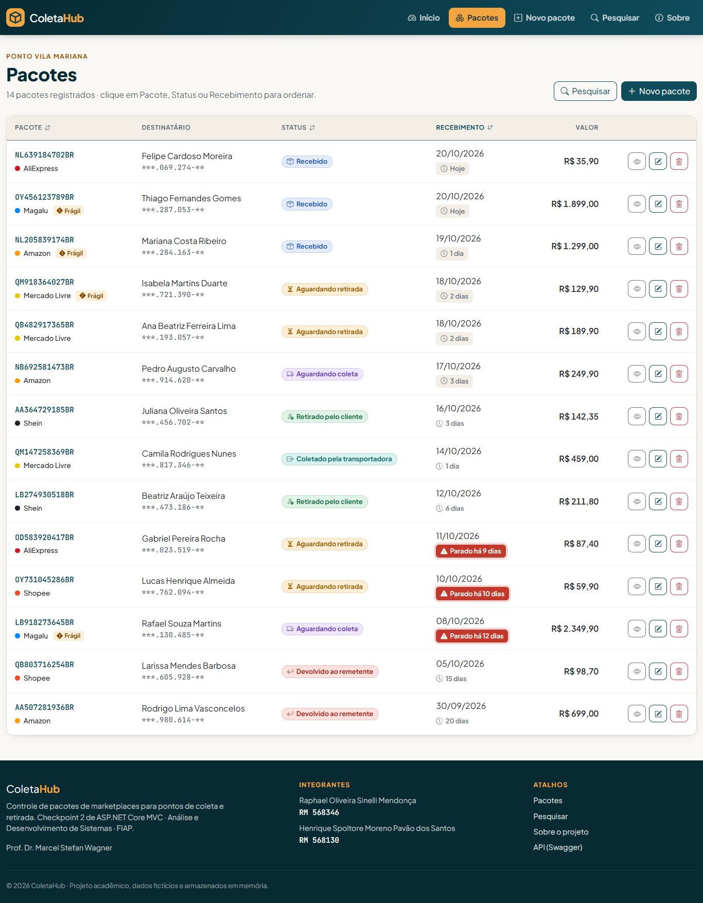

**Para o usuário:** a tabela traz todos os pacotes com código, marketplace, selo de frágil, destinatário (CPF mascarado), status, data de recebimento e tempo no ponto. Os pacotes parados aparecem em vermelho. Clicar em **Pacote**, **Status** ou **Recebimento** ordena a lista; um segundo clique inverte a direção. Cada linha tem os botões Detalhes, Editar e Excluir.

**Implementação:**

- `PacotesController.Index(ordenarPor, decrescente)` ordena com `OrderBy`/`OrderByDescending` e envia a coluna ativa em `ViewData`.
- `Views/Pacotes/Index.cshtml` monta o cabeçalho com `asp-route-ordenarPor`/`asp-route-decrescente` e `aria-sort`.
- Cada linha vem da partial `_LinhaPacote`, que usa os cinco Tag Helpers.

### 12.3 Detalhes

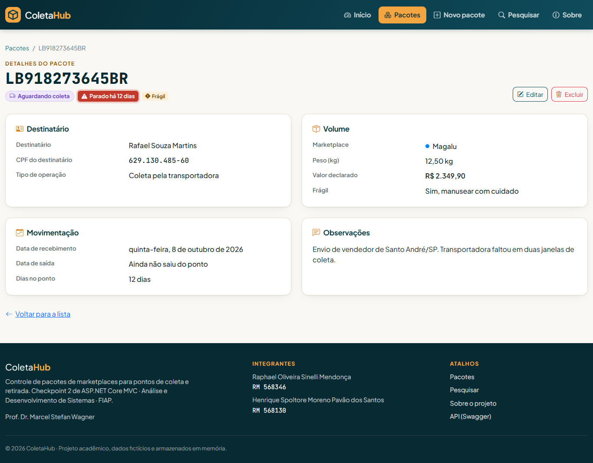

**Para o usuário:** mostra todos os dados do pacote em quatro blocos (Destinatário, Volume, Movimentação, Observações), com o CPF completo e as datas por extenso. Os botões Editar e Excluir ficam no topo.

**Implementação:**

- `PacotesController.Details(id)` devolve `NotFound()` quando o Id não existe, e o middleware de status code mostra a página 404 amigável.
- A view usa `Html.DisplayNameFor` (rótulos do `[Display]`), `EnumExtensions.ObterNomeExibicao()` e `<botao-acao>` sem `modal`, que leva à página de confirmação.

### 12.4 Novo pacote (vazio)

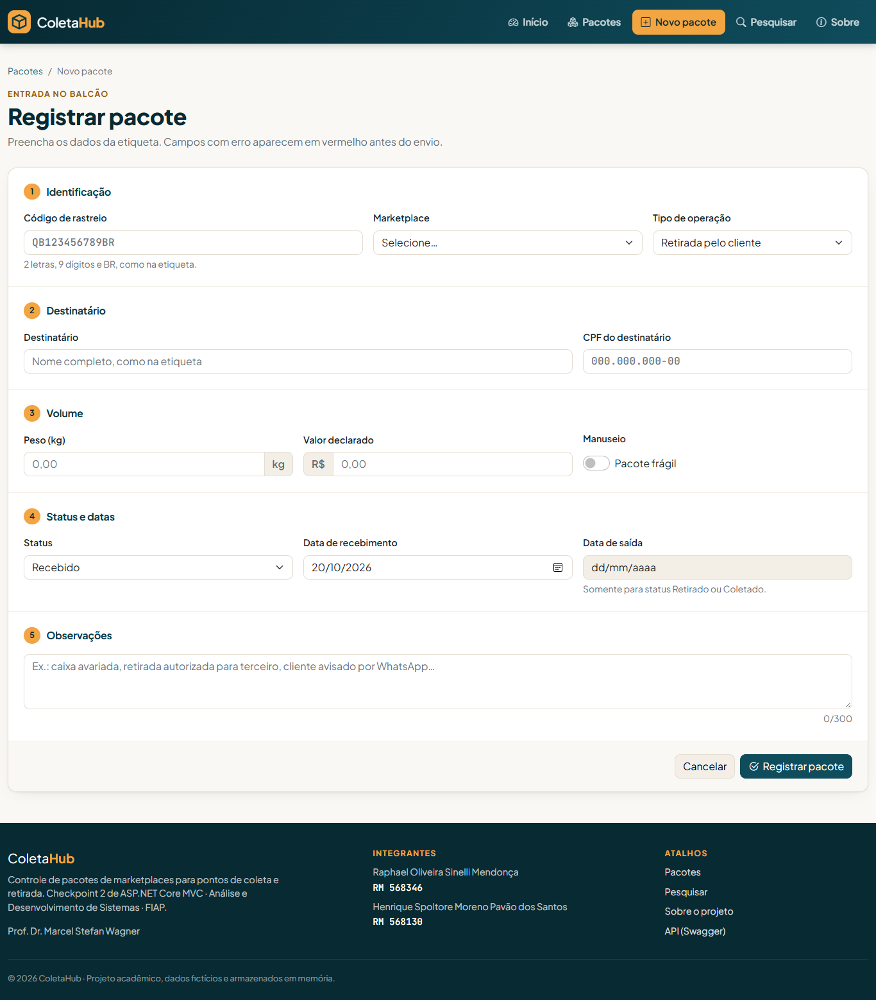

**Para o usuário:** o formulário tem cinco seções numeradas. O código de rastreio vira maiúsculo enquanto é digitado, o CPF ganha máscara, o peso e o valor aceitam vírgula, e a data de recebimento já vem com hoje. A data de saída só é liberada quando o status for Retirado ou Coletado, e as observações têm contador de caracteres.

**Implementação:**

- `Create()` (GET) monta o `PacoteFormViewModel` com `Marketplaces` vindos do `IMarketplaceService`.
- `Create.cshtml` contém o `<form asp-action="Create">` e reaproveita a partial **`_Form.cshtml`** com `<partial name="_Form" model="Model" />`.
- Os comportamentos estão em `wwwroot/js/site.js`.

### 12.5 Novo pacote com erros de validação

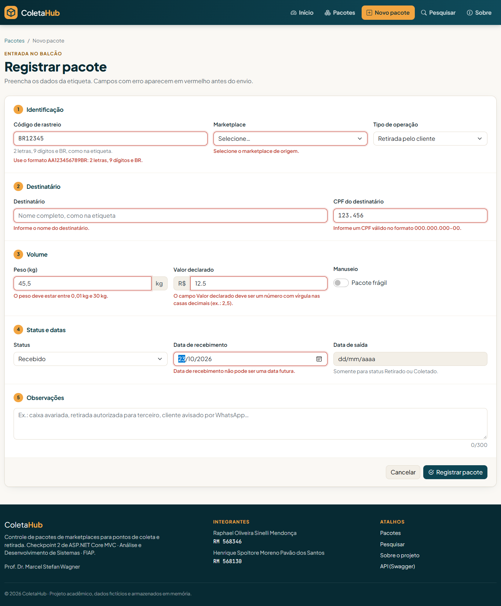

**Para o usuário:** ao tentar salvar, cada campo inválido fica vermelho com a explicação em português, antes de qualquer envio ao servidor. Exemplos: formato do código, marketplace não selecionado, nome vazio, CPF incompleto, peso acima de 30 kg, valor `12.5` (ponto não é aceito) e data de recebimento no futuro.

**Implementação:**

- As Data Annotations geram atributos `data-val-*`.
- O `validacao-ptbr.js` ajusta `number`/`range` para vírgula e registra o adaptador do `[DataNaoFutura]` (`IClientModelValidator`).
- Se o JavaScript estiver desligado, o POST valida tudo de novo no servidor, inclusive o `IValidatableObject`, o catálogo de marketplaces e a unicidade do código. Com `ModelState` inválido, a view volta com o **dropdown repopulado** (`CriarFormulario`).

### 12.6 Editar

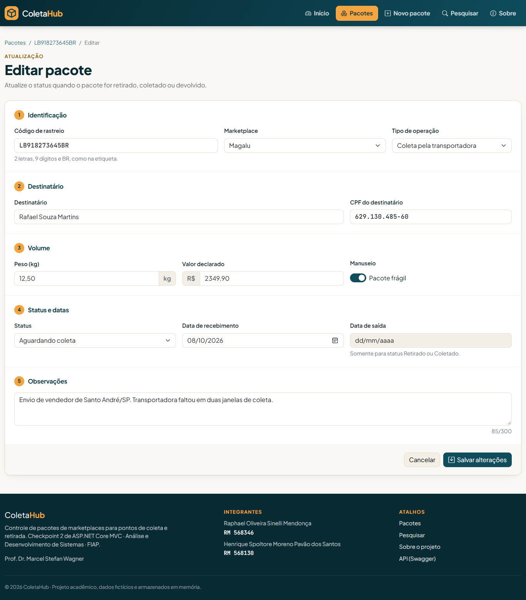

**Para o usuário:** é o mesmo formulário, preenchido. Aqui o operador muda o status (por exemplo, para "Retirado pelo cliente") e informa a data de saída.

**Implementação:**

- `Edit(id)` (GET) carrega o pacote. `Edit(id, formulario)` (POST, `[ValidateAntiForgeryToken]`) confere se o Id da rota bate com o do formulário (senão `BadRequest`), valida e chama `Atualizar`.
- Depois redireciona para Details com `TempData["Sucesso"]`.
- `Pacote.Id` vai em `<input type="hidden" asp-for>`.

### 12.7 Remover: página de confirmação

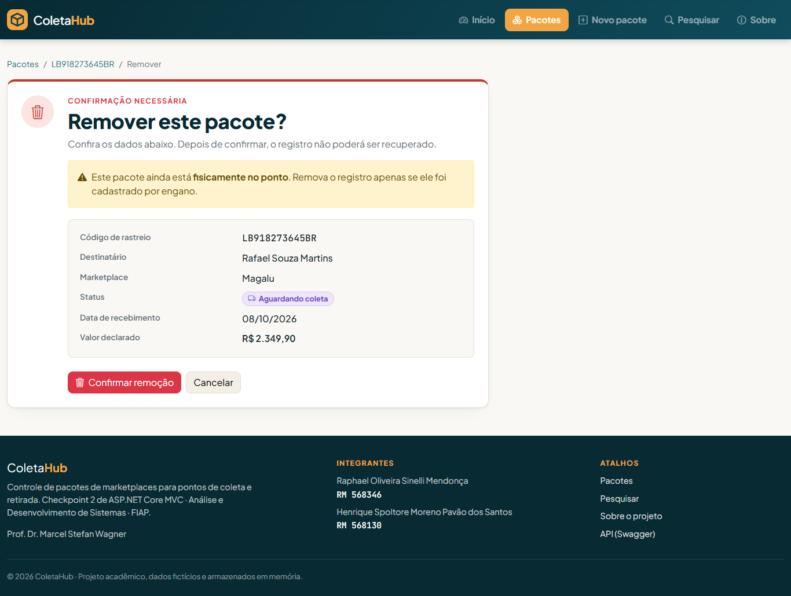

**Para o usuário:** resume o pacote e pede confirmação. Se o pacote ainda estiver fisicamente no ponto, aparece um aviso extra. **Confirmar remoção** exclui; **Cancelar** volta para os detalhes.

**Implementação:** `Delete(id)` (GET) só exibe a tela. A exclusão acontece em `DeleteConfirmed(id)`, um POST marcado com `[ActionName("Delete")]` e `[ValidateAntiForgeryToken]`.

### 12.8 Remover: modal na lista

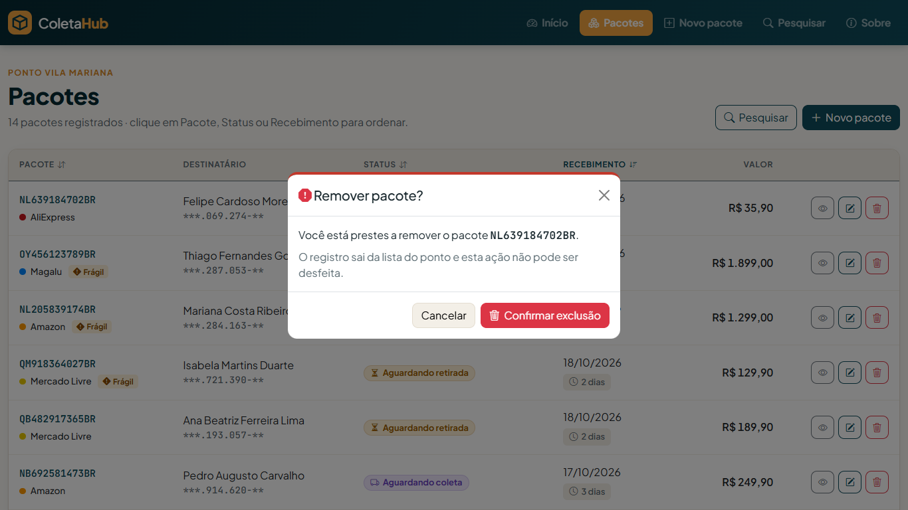

**Para o usuário:** na lista, o botão da lixeira abre um modal com o código do pacote. Nada é removido até clicar em **Confirmar exclusão**.

**Implementação:**

- A partial `_ModalExclusao` (incluída no `_Layout`) tem um `<form method="post" asp-action="Delete">` com antiforgery.
- `<botao-acao tipo="excluir" modal="true">` adiciona os `data-bs-*`.
- O `site.js` escuta `show.bs.modal` e copia a URL do botão para o `action` do form.

### 12.9 Pesquisa com resultados

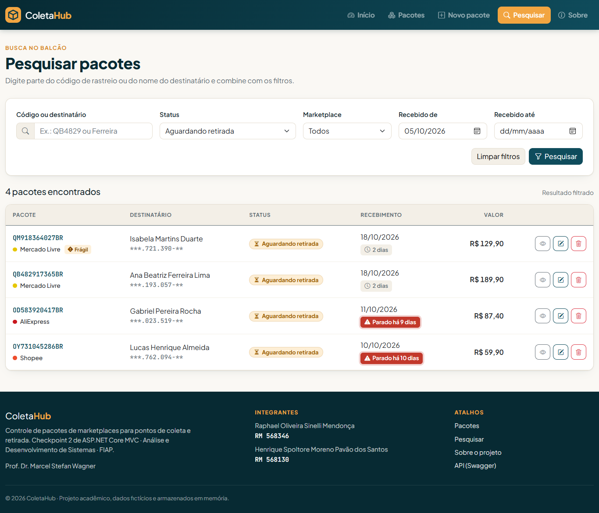

**Para o usuário:** combina texto (trecho do código ou do nome, sem diferenciar maiúsculas), status, marketplace e intervalo de recebimento. Mostra a contagem ("4 pacotes encontrados") e **mantém os filtros preenchidos**.

**Implementação:**

- O formulário é **GET** (`asp-action="Search" method="get"`), então a busca fica na URL e pode ser compartilhada.
- `Search(PacoteSearchViewModel)` valida o intervalo (data final ≥ inicial), chama `IPacoteRepository.Pesquisar(FiltroPacote)` (`Contains` com `StringComparison.OrdinalIgnoreCase`) e devolve o mesmo ViewModel com `Resultados`. Por isso os campos `asp-for` voltam preenchidos.

### 12.10 Pesquisa sem resultados

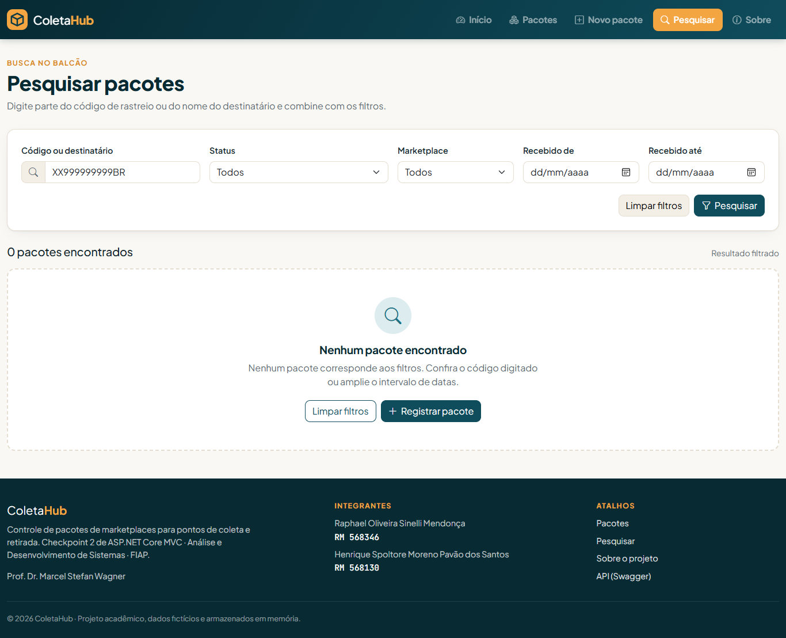

**Para o usuário:** quando nada é encontrado, uma mensagem explica o motivo e oferece "Limpar filtros" e "Registrar pacote".

**Implementação:** `<empty-state>` com ações passadas como conteúdo filho.

### 12.11 Sobre

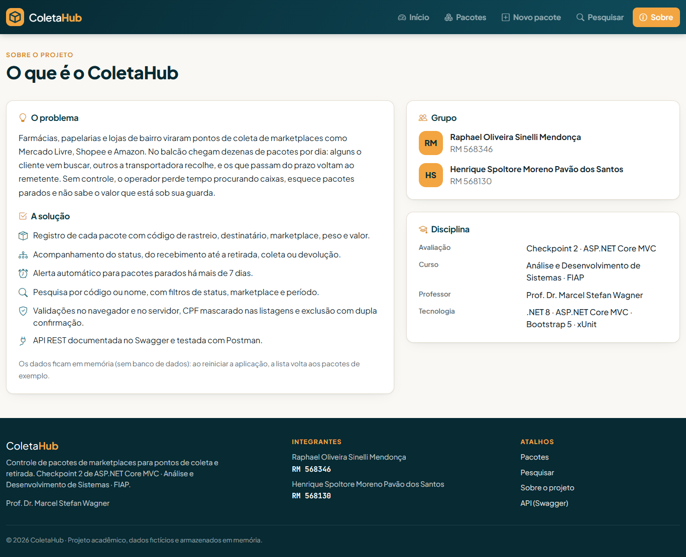

**Para o usuário:** explica o problema, as funcionalidades, o grupo (nomes e RMs) e a disciplina.

**Implementação:** `HomeController.Sobre` com a view estática `Views/Home/Sobre.cshtml`, que substitui a página Privacy do template (removida).

### 12.12 Swagger

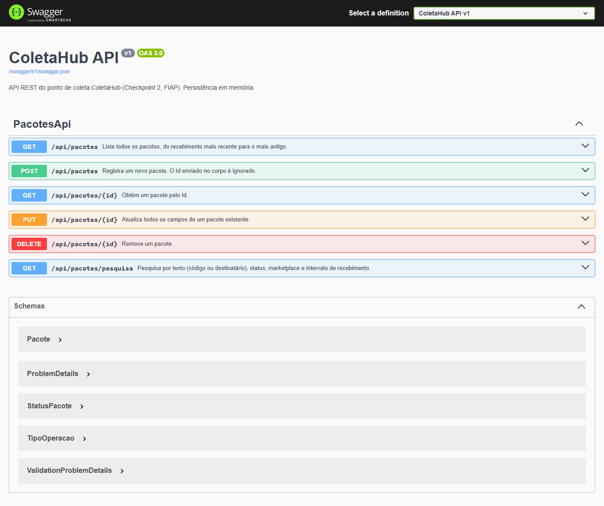

**Implementação:** `AddSwaggerGen` com `IncludeXmlComments`; `UseSwagger`/`UseSwaggerUI` só em Development. O `HomeController` está marcado com `[ApiExplorerSettings(IgnoreApi = true)]` para não aparecer na documentação.

### 12.13 Celular

| Pacotes (Index) | Painel |
|---|---|
| 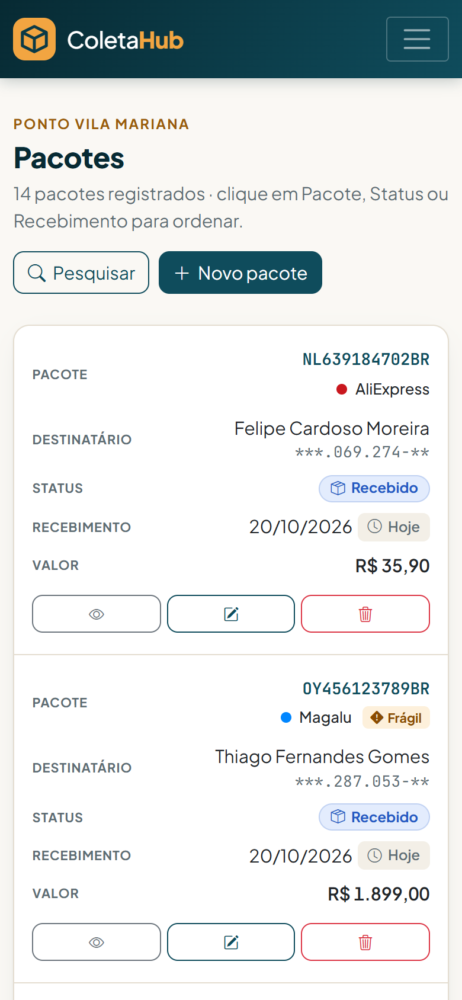 | 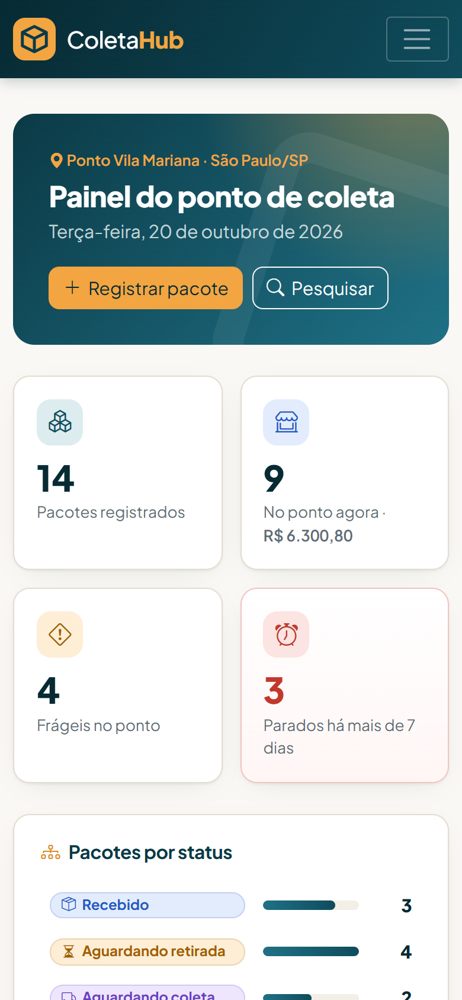 |

**Para o usuário:** a navbar vira menu sanduíche, os cards do painel ficam dois por linha e **cada linha da tabela vira um cartão** com rótulos.

**Implementação:** uma media query em `site.css` (`max-width: 767.98px`) troca a tabela para `display: block` e usa `td[data-label]::before { content: attr(data-label) }`. Os `data-label` vêm de `_LinhaPacote`.

### 12.14 Página 404 amigável

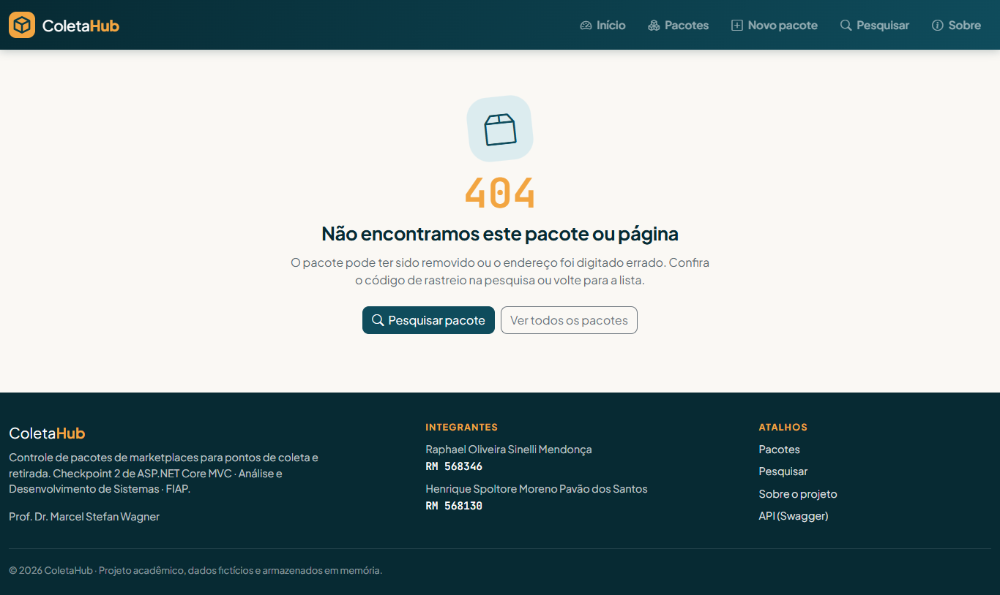

**Implementação:** quando uma action devolve `NotFound()` ou a rota não existe, `UseStatusCodePagesWithReExecute("/erro/{0}")` re-executa `HomeController.ErroHttp(404)`, que renderiza `Views/Shared/NaoEncontrado.cshtml`. Exceções vão para `Views/Shared/Error.cshtml`. As rotas `/api` ficam fora, para continuarem respondendo JSON.

### 12.15 Mensagem de sucesso (TempData)

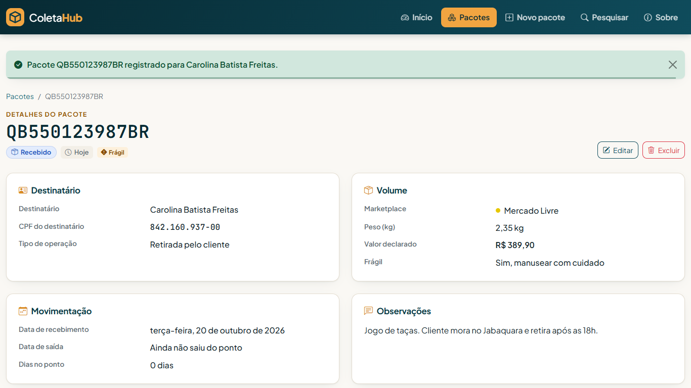

**Para o usuário:** depois de salvar, editar ou excluir, uma faixa confirma a ação e some sozinha em 5 segundos (a barra inferior mostra o tempo).

**Implementação:** o controller grava `TempData["Sucesso"]` ou `TempData["Erro"]` antes do `RedirectToAction`. A partial `_Alertas` (no `_Layout`) exibe a mensagem e o `site.js` fecha o alerta com `bootstrap.Alert`.

---

## 13. Testes

### 13.1 xUnit: 67 testes passando

```bash
dotnet test
# ou, no Visual Studio: Testar → Executar Todos os Testes
```

| Arquivo | O que cobre |
|---|---|
| `InMemoryPacoteRepositoryTests` (16) | Adicionar (Id incremental), obter por Id (existente, inexistente, cópia isolada), atualizar (existente e inexistente), remover, **pesquisar por trecho do código sem diferenciar maiúsculas**, pesquisar por nome, **filtrar por status**, combinar marketplace e datas, unicidade do código, cobertura do seed |
| `PacotesControllerTests` (16) | **Create com ModelState inválido retorna a view com o dropdown repopulado**, Create válido redireciona com TempData, marketplace fora do catálogo, código duplicado, **Delete de Id inexistente retorna NotFound**, Details/Edit inexistentes, Delete GET não remove, DeleteConfirmed remove (e trata Id inexistente), Edit com Id divergente, Search filtra e mantém filtros, intervalo de datas invertido, ordenação da Index |
| `ValidacaoPacoteTests` (27) | **`[DataNaoFutura]`** (amanhã inválido, hoje válido, nulo válido, mensagem), **`IValidatableObject`** (saída antes do recebimento, saída com status que não saiu, saída obrigatória para Retirado), formato de código e CPF, faixa de peso, tamanho das observações, `DiasNoPonto`, `CpfMascarado`, todos os pacotes do seed válidos |
| `PacotesApiControllerTests` (8) | 200, 201 com `CreatedAtAction`, 204, 400 e 404 da API |

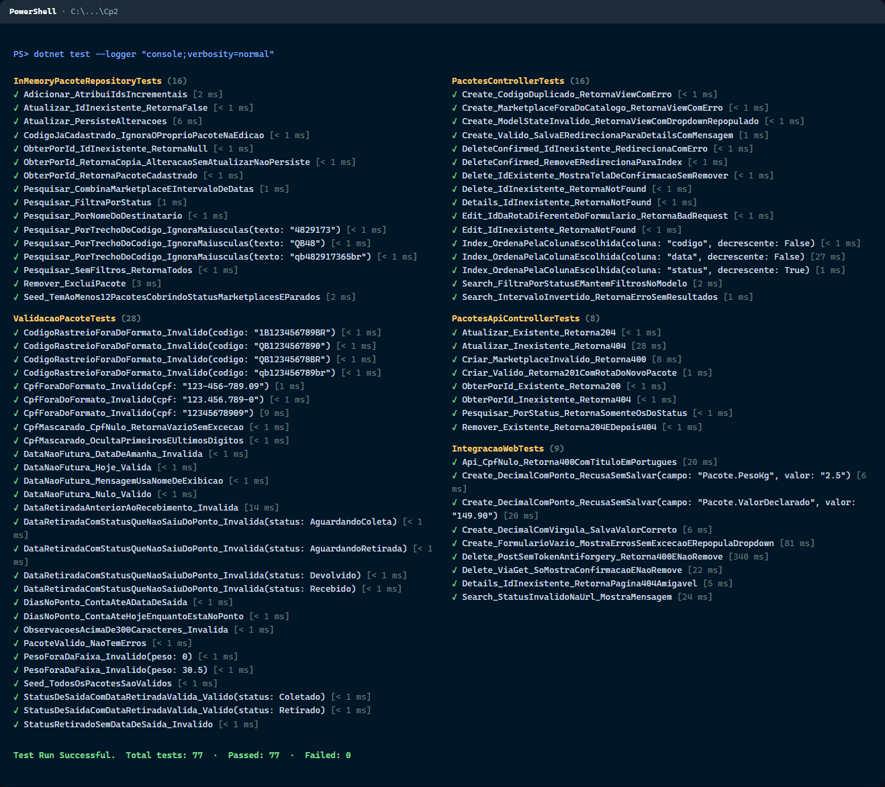

### 13.2 Postman: 13 requisições, 29 asserções

Coleção: [`docs/postman/ColetaHub.postman_collection.json`](docs/postman/ColetaHub.postman_collection.json)

**Como importar e rodar no Postman:**

1. Inicie a aplicação no perfil **http** (`http://localhost:5279`). No Visual Studio, escolha o perfil "http" antes do F5; na CLI, use `dotnet run --project src/ColetaHub.Web --launch-profile http`.
2. No Postman, clique em **Import** e selecione o arquivo da coleção.
3. Se usar outra porta, edite a variável **`baseUrl`** da coleção (aba *Variables*).
4. Clique nos três pontos da coleção, escolha **Run collection** e depois **Run ColetaHub API**. Rode em ordem: o POST guarda o Id em `pacoteId`, usado pelas requisições seguintes.

As requisições encadeiam um ciclo completo:

- listar e pesquisar;
- criar (201 com header `Location`), criar inválido (400) e criar duplicado (400);
- obter, atualizar para "Retirado" (204) e conferir a alteração;
- atualizar inexistente (404), excluir (204), obter excluído (404) e excluir de novo (404).

Cada requisição tem scripts `pm.test` que verificam o status HTTP e os campos do JSON. O código de rastreio é aleatório a cada execução, então a coleção pode ser repetida sem reiniciar a aplicação.

**Pela linha de comando (Newman):**

```bash
npx newman run docs/postman/ColetaHub.postman_collection.json
```

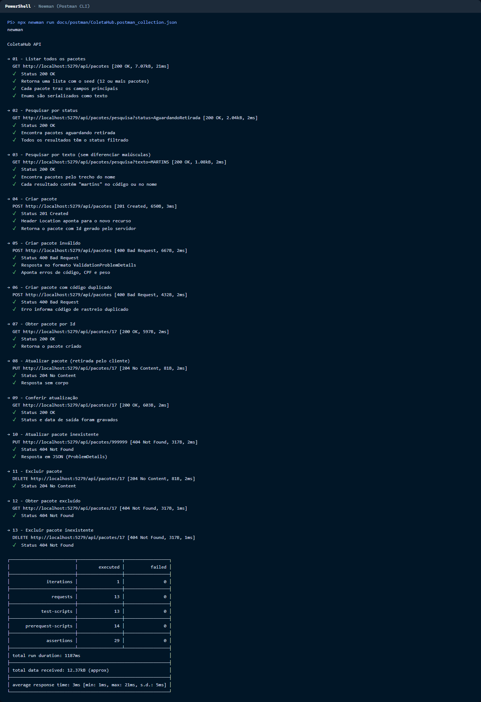

Relatório HTML da execução (Newman + htmlextra): [`docs/postman/relatorio-newman.html`](docs/postman/relatorio-newman.html)

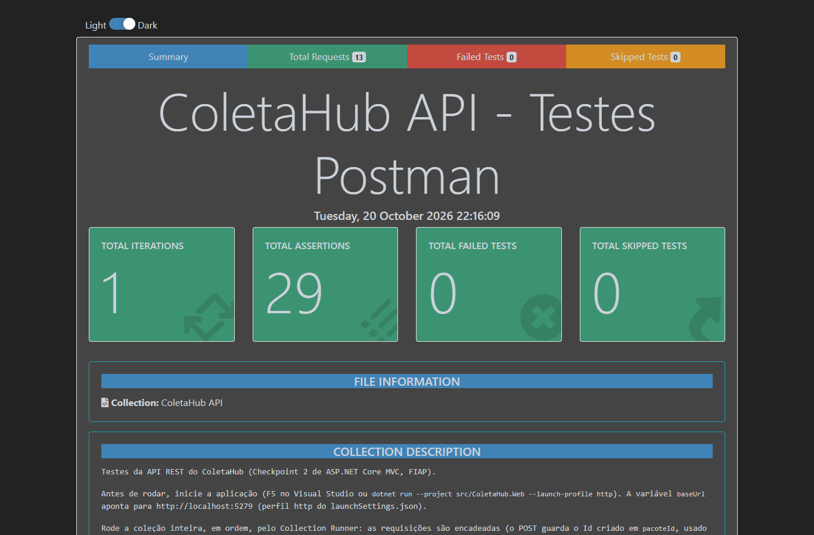

---

## 14. Confirmação de exclusão

A remoção tem **duas camadas de confirmação** e **só acontece via POST com token antiforgery**:

1. **Página Delete** (`GET /Pacotes/Delete/{id}`): mostra o resumo do pacote, avisa se ele ainda está no ponto e oferece **Confirmar remoção** (POST) ou **Cancelar**. É o caminho a partir de Details e também o de quem navega sem JavaScript.
2. **Modal Bootstrap** na Index e na Pesquisa: o botão da lixeira (`<botao-acao tipo="excluir" modal="true">`) abre `#modalExclusao` com o código do pacote. O formulário do modal faz o POST para a mesma URL.

Nos dois casos, o `PacotesController.DeleteConfirmed` (`[HttpPost]`, `[ActionName("Delete")]`, `[ValidateAntiForgeryToken]`) remove o pacote e redireciona para a Index com a mensagem em TempData. Um link ou requisição GET nunca apaga nada.

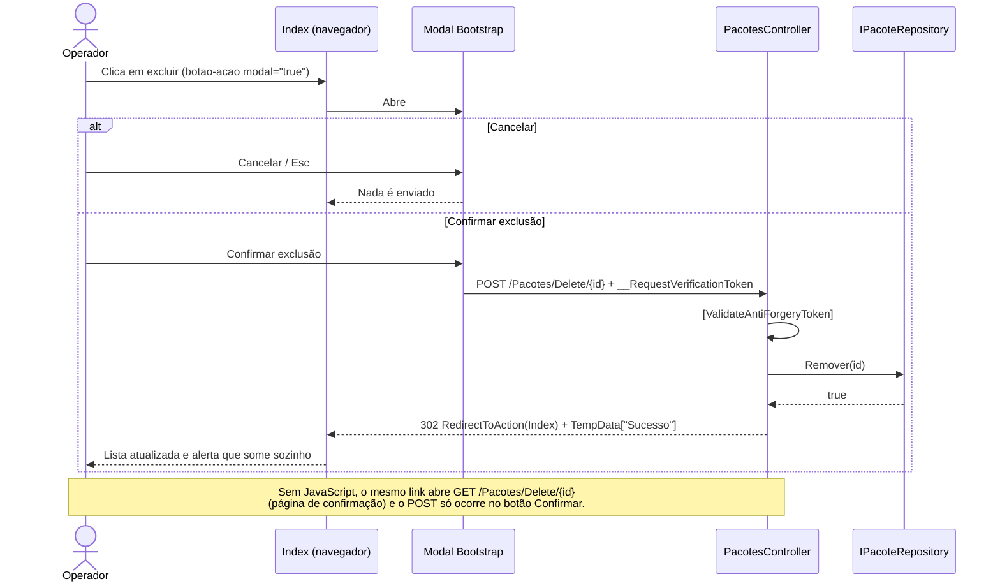

---

## 15. Persistência em memória

Seguindo o requisito, **não há banco de dados**. Os pacotes ficam em um `ConcurrentDictionary<int, Pacote>` dentro do `InMemoryPacoteRepository`:

- **Singleton:** registrado com `AddSingleton`, existe uma única instância durante toda a execução. Ela é compartilhada por todas as requisições, pelo site MVC e pela API, por isso um POST feito no Postman aparece na hora no navegador.
- **Thread-safe:** o `ConcurrentDictionary` e o `Interlocked.Increment` (Id incremental) evitam conflito entre requisições simultâneas.
- **Cópias isoladas:** o repositório devolve clones (`Pacote.Clonar()`). Alterar um objeto em memória sem chamar `Atualizar` não muda o dado armazenado.
- **Seed:** `PacoteSeed.Criar()` carrega 14 pacotes realistas, com todos os status, os 6 marketplaces, 4 frágeis e 3 parados há mais de 7 dias. As datas são relativas ao dia em que a aplicação sobe, então o painel sempre tem pacotes recentes e parados.

**Por que os dados reiniciam?** A memória do processo é liberada quando a aplicação para. Ao rodar de novo (F5 ou `dotnet run`), um novo repositório é criado a partir do seed. Tudo o que foi cadastrado, editado ou excluído antes se perde, e esse é o comportamento esperado para este checkpoint.

---

## 16. Melhorias futuras

- **Entity Framework Core com Oracle** (banco usado na FIAP): criar `OraclePacoteRepository : IPacoteRepository` com `DbContext` e migrations e trocar uma linha no `Program.cs`. Nenhum controller muda.
- **Autenticação e perfis** com ASP.NET Core Identity: operador do ponto, supervisor (vê vários pontos) e auditoria de quem registrou cada saída.
- **Etiquetas com QR code** para cada pacote, com leitura pela câmera do celular para buscar o pacote no balcão.
- Notificação ao cliente por WhatsApp ou e-mail quando o pacote chega e quando completa 7 dias parado.
- Prazo de guarda configurável por marketplace e devolução automática ao vencer.
- Paginação na lista e exportação CSV.

---

## 17. Decisões registradas

| Decisão | Motivo |
|---|---|
| `net8.0` com SDK 10 fixado no `global.json` | Abre e roda no VS 2022 e no VS 2026 |
| Swashbuckle em vez de OpenAPI nativo com Scalar | Caminho indicado para .NET 8 |
| CPF em vez de telefone | É o documento conferido na retirada |
| Formato do código `AA123456789BR` | Padrão das etiquetas nacionais de rastreio |
| Data de saída obrigatória para Retirado/Coletado | Completa a regra do `IValidatableObject`: se o pacote saiu, a data precisa existir |
| Marketplace validado contra o catálogo também no servidor | Impede valores forjados no POST que não vieram do dropdown |
| Código de rastreio único | Dois pacotes com o mesmo código confundiriam o balcão |
| CPF mascarado nas listagens | Minimiza exposição de dado pessoal (LGPD); o CPF completo aparece só em Details |
| Coluna "Pacote" agrupa código, marketplace e frágil | Mantém a tabela legível em 1366 px sem rolagem horizontal |
| Cultura pt-BR fixa | O sistema é brasileiro; datas, moeda e decimais sempre no padrão nacional |
| `TempData` com chaves em constantes (`PacotesController.ChaveSucesso`) | Evita strings mágicas espalhadas entre controller e view |
